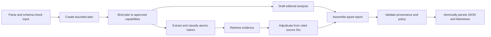
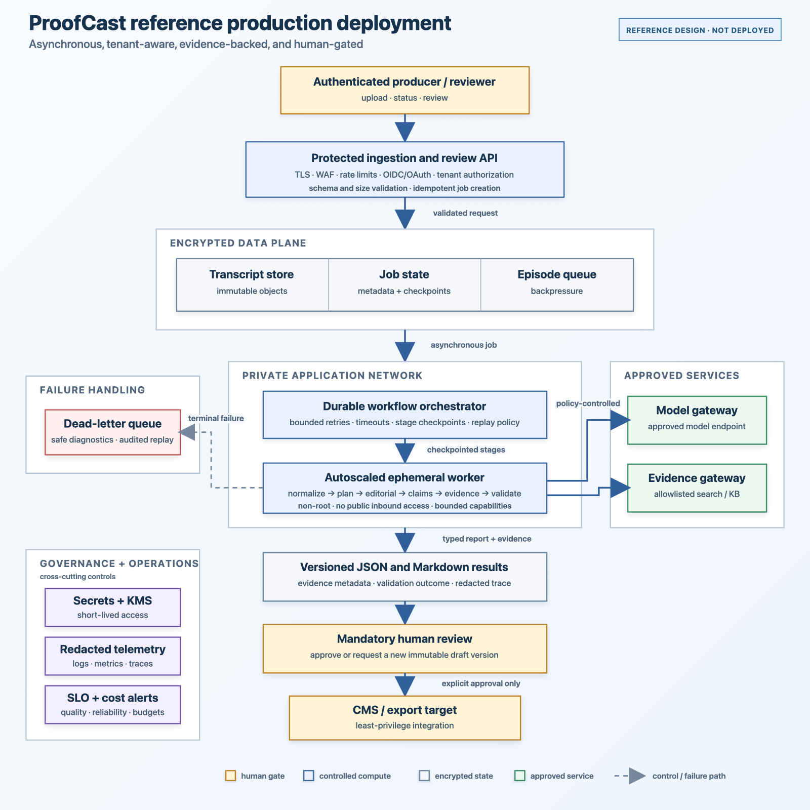

# ProofCast

[](https://github.com/asapalejandro/proofcast/actions/workflows/ci.yml)

ProofCast is an evidence-first podcast editorial workflow. It turns timestamped transcripts into typed JSON and reviewer-friendly Markdown containing a 200–300-word summary, exactly five takeaways, verbatim notable quotes, topic tags, atomic claims, conservative fact-check verdicts, and evidence metadata.

All sample inputs and outputs in this repository are synthetic. No private or third-party transcripts are included.

## Evaluator guide

The assignment deliverables are surfaced directly below so each requirement can be reviewed without searching the repository.

| Assignment requirement | Evidence in this repository |
|---|---|
| **1. Summarization** — approximately 200–300 words covering themes, discussions, and outcomes or opinions | Typed report models and deterministic validation in [`models.py`](src/proofcast/models.py) and [`validators.py`](src/proofcast/validators.py) |
| **2. Key Notes Extraction** — top five takeaways, timestamped notable quotes, and topic tags | Structured generation plus quote-provenance and exact-count checks in [`orchestrator.py`](src/proofcast/orchestrator.py) and [`validators.py`](src/proofcast/validators.py) |
| **3. Fact-Checking (Agentic Component)** — identify claims, retrieve or reason over evidence, and assign the required verdict | Bounded claim/evidence workflow in [`orchestrator.py`](src/proofcast/orchestrator.py) · live web-search adapter in [`openai.py`](src/proofcast/providers/openai.py) · deterministic evidence snapshot in [`fixture.py`](src/proofcast/providers/fixture.py) |
| Source code, containerized and runnable locally via Docker | [`src/proofcast/`](src/proofcast/) · [`Dockerfile`](Dockerfile) · [`compose.yaml`](compose.yaml) · [credential-free quick start](#quick-start) |
| Local or cloud model path | [Fixture and OpenAI providers](#providers); the fixture path is deterministic and credential-free, while the OpenAI path is live-capable and credential-gated |
| Detailed README | Setup, provider, execution, output, security, and limitations are documented on this page |
| Readable agent plans and execution logs | [Output contract](#output-contract) · generated content-redacted JSONL traces under `outputs/public-demo/traces/` |
| Output JSON and Markdown with summary, notes, and fact checks | [Quick start](#quick-start) · generated `results.json` and per-episode JSON/Markdown under `outputs/public-demo/` |
| **Detailed Deployment Strategy** | [Full production deployment narrative](docs/DEPLOYMENT.md) |
| **Diagram** | [Rendered PNG](docs/deployment-architecture.png) · [accessible SVG](docs/deployment-architecture.svg) · [editable Mermaid source](docs/deployment-architecture.mmd) |
| **Narrative description** | [Deployment, cost, scalability, fault tolerance, and other non-functional considerations](docs/DEPLOYMENT.md#narrative-description) |

## Quick start

Docker Compose is the shortest credential-free path:

```bash
mkdir -p outputs/public-demo
PROOFCAST_UID="$(id -u)" PROOFCAST_GID="$(id -g)" \
docker compose run --build --rm proofcast
```

The command writes canonical JSON, Markdown, JSON Schema, and a content-redacted JSONL execution trace under `outputs/public-demo/`. The fixture provider is intentionally deterministic; it is a reproducible demonstration, not a claim that live web research occurred.

## Design

ProofCast uses models for semantic judgment and deterministic software for guarantees:



The outer workflow is bounded: a model-authored eight-step plan must bind to approved capabilities and preserve dependency order before any stage executes. Within that boundary, the model performs the judgment-heavy work—editorial synthesis, claim selection, claim classification, evidence search, and verdict synthesis.

Pydantic and application validators enforce properties that prose generation alone cannot guarantee:

- 200–300 summary words and exactly five unique takeaways;
- timestamped quotes that match a source turn verbatim;
- atomic claims with a verbatim source excerpt;
- exact verdict labels and evidence required for affirmative or cautionary verdicts;
- safe episode identifiers, evidence URLs, plan dependencies, and atomic writes.

Fact-check verdicts preserve the brief's three labels exactly: `Verified true`, `Possibly outdated/inaccurate`, and `Unverifiable`.

## Providers

- `fixture` is the credential-free demo and CI path. Its output records the fixture provider and snapshot model explicitly.
- `openai` uses the Responses API, Pydantic Structured Outputs, and hosted web search. It requires the optional `openai` package extra, a separately billed API project, and `OPENAI_API_KEY`.

Example live invocation:

```bash
python -m pip install -e '.[openai]'
# Set OPENAI_API_KEY through a secret manager or hidden-input shell workflow.
proofcast run path/to/transcript.json \
  --provider openai \
  --model gpt-5.6-sol \
  --reasoning-effort medium \
  --output outputs/live
```

Never paste a key into source code, a committed file, or shell history. The documented `gpt-5.6-sol` model supports the Responses API, Structured Outputs, and hosted web search; actual access depends on the API project's model and billing configuration. See the [official OpenAI model documentation](https://developers.openai.com/api/docs/models/gpt-5.6-sol).

## Local development

Python 3.11 or newer is required.

```bash
python3 -m venv .venv
source .venv/bin/activate
python -m pip install --upgrade pip
python -m pip install --require-hashes -r requirements.txt
python -m pip install --no-deps -e .
PYTHONDONTWRITEBYTECODE=1 PYTHONPATH=src python -m unittest discover -s tests -v
```

Run the synthetic example without Docker:

```bash
proofcast run examples/public_demo_transcript.json \
  --provider fixture \
  --fixture fixtures/public_demo_reports.json \
  --output outputs/public-demo
```

## Output contract

```text
outputs/public-demo/
├── .proofcast-run.json
├── results.json
├── schema.json
├── episodes/
│   ├── public-demo-001.json
│   └── public-demo-001.md
└── traces/
    └── <trace_id>.jsonl
```

Logs expose plan bindings, capability execution, per-claim routing, verdicts, evidence counts, duration, validation, and safe failures. They intentionally exclude raw transcripts, prompts, claims, source URLs, credentials, provider responses, and hidden chain-of-thought.

## Security and data handling

The fixture demo runs as a non-root user with a read-only container filesystem, all Linux capabilities dropped, `no-new-privileges`, and networking disabled. Input size and shape are bounded before provider calls, output paths are constrained, trace identifiers are validated, evidence URLs are limited to HTTP(S) without embedded credentials, and untrusted report text is escaped before Markdown rendering.

Live mode is a different trust boundary: it sends the full transcript to OpenAI for planning, editorial analysis, and claim extraction, then sends factual claims or search queries to hosted web search. Requests set `store=False`, but that does not replace an organization's data-classification, retention, residency, or provider-approval requirements. Do not submit confidential or regulated content without approval, and review every generated report before distribution. See [SECURITY.md](SECURITY.md) for vulnerability reporting.

## Detailed Deployment Strategy

> **Status:** The following is the required reference design and narrative, not infrastructure claimed to be deployed by this repository.



The complete [narrative description](docs/DEPLOYMENT.md) explains the request lifecycle and explicitly covers deployment, cost management, scalability and performance, fault tolerance and recovery, security and privacy, tenant isolation, observability, human review, and release operations. The diagram is also provided as an [accessible SVG](docs/deployment-architecture.svg) and editable [Mermaid source](docs/deployment-architecture.mmd).

The provider protocol isolates planning, editorial generation, claim extraction, and verification from vendor SDKs. The reference production service runs the same immutable worker behind an asynchronous queue with tenant-scoped storage, idempotent checkpoints, bounded retries, a dead-letter path, evidence freshness policy, cost quotas, content-redacted telemetry, and mandatory human approval before export.

### Current implementation boundary

The implemented V1 has one live-capable adapter: OpenAI. It is contract-tested but requires a separately billed API key for live execution. A proposed V2 would add a capability-aware provider registry for tenant BYOK and approved client-managed endpoints such as Ollama. This is planned—not current support. Each provider would need conformance and quality evaluations, opaque secret references, and an explicit evidence path; a local model without approved retrieval could not produce an evidence-backed affirmative verdict.

Known limitations are explicit: the public demo uses a fixed evidence snapshot; the live adapter requires an API key and provider access; long-transcript chunking and durable checkpoint recovery are deployment concerns; and ProofCast creates drafts rather than publishing automatically.

## License

Copyright © 2026 Alejandro Palumbo. All rights reserved. This repository is published for portfolio review; no license to copy, modify, or redistribute the source is granted.
